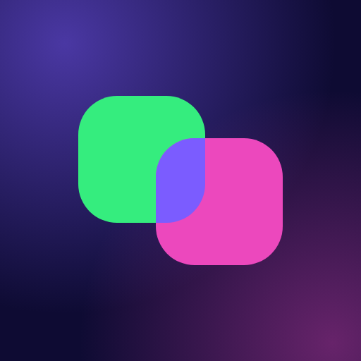

<p align="center">
  
</p>

# Prompt Battle

A live, on-stage **prompt-battle tournament**. Two players go head-to-head: each
gets the same task and races to write the best prompt. An AI model turns their
prompts into images (or videos), the results are revealed side by side on a
projector, and the audience votes for the winner. Single-elimination bracket,
2 to 32 players.

Built for workshops, team events, classrooms and meetups — anywhere you want to
turn "learning to prompt" into a spectator sport.

**Play it at [promptbattle.io](https://promptbattle.io)** — free for up to 8
players, CHF 9 per tournament for bigger events with video rounds, or free with
your own AI API key. Or host it yourself from this repository.

## How it works

Three views, three screens:

| View | URL | Who | What |
|------|-----|-----|------|
| **Host** | `/admin` | Organizer (laptop) | Create tournaments, add tasks, run matches, control reveals & voting |
| **Players** | `/` → join with code | Players (phones) | Join via QR/code, type prompts against the clock, vote |
| **Stage** | `/stage/<code>` | Projector | Bracket, live match, reveal animation, voting, champion |

A **task** is either an image to recreate (players see a reference image), a
text brief ("generate an image of…"), or a video brief. Players never see each
other's prompts until the reveal.

## Features

- **10 languages** — English, German, French, Italian, Spanish, Portuguese,
  Chinese, Japanese, Hindi and Arabic (right-to-left); every player picks their own
- **Any AI model** — Google (Nano Banana 2.1 / Pro, Gemini Omni video), OpenAI
  (GPT Image 2.5) and Replicate (FLUX, Veo, Kling, Seedance and thousands more),
  addressed as `<provider>:<model id>`
- **Host accounts** — Google, GitHub, emailed login link (with a one-time code
  fallback) or email + password; each host only sees their own tournaments
- **Plans** — free tier with hard cost caps, pay-per-event upgrade via Stripe
  (cards, TWINT), or bring-your-own keys stored encrypted per tournament
- **Test mode** — rehearse the whole flow without any AI calls
- **On site or online** — projector in the room, or share the stage in a video call

## Tech stack

- **Next.js 16** (App Router, Server Actions) + **React 19** + **Tailwind v4**
- **Supabase** — Postgres, Auth, Realtime (live sync across all three views), Storage
- **Stripe** Checkout for pay-per-event upgrades, **Resend** for email
- Deploys to **Vercel**

## Self-hosting

You run it on your own Supabase project and your own AI provider keys, so
**you** control (and pay for) the generations your tournaments produce.

### Prerequisites

- Node.js 20+
- A free [Supabase](https://supabase.com) project
- An API key for at least one AI provider — [Google Gemini](https://aistudio.google.com/apikey)
  (default models), [OpenAI](https://platform.openai.com/api-keys) or
  [Replicate](https://replicate.com/account/api-tokens). Only needed for real
  generation — Test Mode skips all API calls.

### 1. Install

```bash
git clone https://github.com/ShaunBaumberger/promptbattle.git
cd promptbattle
npm install
```

### 2. Set up the database

In your Supabase project, open **SQL Editor** and run every file in
[`supabase/migrations/`](supabase/migrations/) **in filename order**
(`0001…`, `0002…`, … `0008…`, `0008b…`, `0009…` up to the highest number).

The migrations create the tables, Row-Level-Security policies, the Realtime
publication and a public Storage bucket named `images`. Apply each file once;
re-running one on an existing database errors on already-applied statements.

### 3. Set up sign-in

Hosts sign in with **Supabase Auth**. In the Supabase dashboard → Authentication:

- **URL Configuration:** set the Site URL to your domain (or
  `http://localhost:3000`) and add `<your site>/auth/callback` plus
  `http://localhost:3000/**` as redirect URLs.
- **Sign In / Providers:** email is on by default. Google and GitHub are
  optional (each needs an OAuth app pointing at your project's
  `/auth/v1/callback`).
- **Emails → SMTP Settings:** Supabase's built-in mailer only reaches your own
  team, so connect an SMTP provider (e.g. [Resend](https://resend.com)) before
  real hosts sign up by email.
- **Email templates (optional):** branded login emails in all 10 languages live
  in [`supabase/email-templates/`](supabase/email-templates/) — see its README.

### 4. Configure environment

```bash
cp .env.local.example .env.local
```

Fill in your Supabase URL + keys, at least one AI provider key and
`SECRETS_ENCRYPTION_KEY`. Every variable — including Stripe, the legal-page
details and model selection — is documented inline in the example file.

### 5. Run

```bash
npm run dev
```

Open <http://localhost:3000>. The host area is at `/admin`; sign in with
any of the methods you enabled.

## Running an event

1. **Host:** sign in at `/admin`, create a tournament, pick the player count and
   round time.
2. **Host:** add tasks for each round (image references, or text/video briefs).
3. **Stage:** open `/stage/<code>` on the projector — it shows a join QR code.
4. **Players:** scan the QR (or go to the site and enter the code) on their
   phones.
5. **Host:** start the tournament, then run each match: *prepare → start →*
   (players prompt) *→ generate → reveal → vote → next.*

**Test Mode** (in tournament settings) skips all AI API calls so you can
rehearse the whole flow for free.

## Deploying to Vercel

Import the repo on [Vercel](https://vercel.com/new), add the same environment
variables, and deploy. Notes:

- Server actions that generate images set `maxDuration = 60` to fit Vercel's
  function budget. Video models render longer than that, so video generation
  uses a **polling architecture** (kick off the job, then short poll calls pick
  up the result) — no single function blocks on the render.
- Vercel caps request bodies at **4.5 MB**. Reference-image uploads are resized
  client-side to stay well under that, so phone photos upload fine.
- Vercel's Hobby plan is for non-commercial use; a deployment that takes
  payments needs Pro.

## Cost

You pay your AI provider directly for generations on your key. Ballpark per
match (two players, default Google models):

- **Image task:** ~$0.27 with Nano Banana Pro, ~$0.07 with Nano Banana 2.1
- **Video task:** ~$1.60–2.00 (two Gemini Omni Flash clips at ~$0.10/s) plus
  the backup images

Image-only tournaments are cheap. Video is the expensive option — use it
sparingly (e.g. only the final). Cheaper models (e.g. Nano Banana 2.1 at
~$0.03, or FLUX Schnell on Replicate) are one setting away.

## Roadmap

Ideas that would take it further — PRs welcome:

- **Automated setup** — a script instead of pasting migrations into the SQL editor
- **More providers** — e.g. Stability, fal.ai, local models via ComfyUI
- **Teams** — several hosts sharing tournaments within an organization
- **More task types** — e.g. style transfer or "guess the prompt" rounds

## License

[AGPL-3.0-or-later](LICENSE). You're free to use, modify and self-host. If you
run a **modified** version as a network service, the AGPL requires you to make
your source available to its users. The name, logo and the promptbattle.io
domain are not covered by the license.

Built by [Shaun Baumberger](https://github.com/ShaunBaumberger), with
[Claude Code](https://claude.com/claude-code) as pair programmer.
